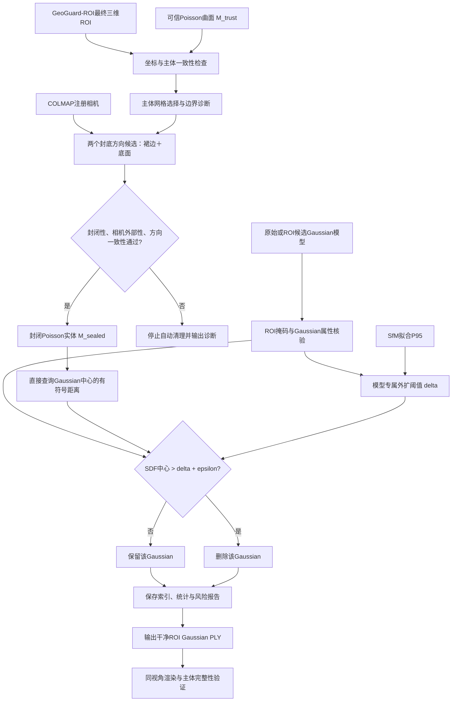

# 从可信Poisson曲面与三维ROI到干净Gaussian场景的完整技术方案

**方法名称：GeoGuard-ROI与可信SfM曲面约束的自适应直接SDF清理**  
**版本：V1.0｜技术路线整合稿｜2026年11月5日**  
**适用对象：无人机影像构建的大尺度自然景观3D Gaussian Splatting（3DGS）场景**  
**工程目标：在尽量保护ROI内真实主体的前提下，识别并移除缺乏可信几何支撑的外围Gaussian，输出可直接用于3DGS渲染的干净ROI场景。**

> **文档范围说明**：本方案从**可信Poisson曲面与已确定的三维ROI**开始，不重复介绍原始SfM点云净化、Poisson重建或双正交ROI交互界面的完整前置开发过程。它将已验证的“封闭Poisson＋模型自适应阈值＋直接SDF判别”与GeoGuard-ROI的正式输入输出接口统一起来。文中以“已验证”标注送子观音实测结论，以“集成要求／待验证”标注尚未完成端到端验证的GeoGuard-ROI联调及安全增强项。

---

## 1. 研究目标、范围与最终原则

### 1.1 解决的问题

复杂自然景观3DGS重建中，Gaussian场不仅包含岩壁、植被、建筑和地表等真实主体，也可能存在漂浮簇、灰黑雾团、放射状拖影等几何异常。仅依靠AABB、OBB或由开放Poisson表面最近面片法向推断的局部内外关系，往往难以兼顾目标完整性和外围异常清理。

本方案以**可信Poisson曲面提供场景主体几何先验**，以**已确定的三维ROI限定用户希望保留的目标范围**，构建可靠的封闭几何实体，利用SfM曲面拟合误差与Gaussian尺度共同确定保留容差，再**直接计算Gaussian中心到封闭实体的有符号距离（SDF）**，完成保留／删除判断。

### 1.2 三项核心原则

1. **ROI决定“研究哪个主体”，SDF决定“主体附近哪些Gaussian具有足够空间归属依据”。** 两类约束同时成立才进入最终清理模型；ROI保护不意味着无条件保留所有Gaussian。
2. **可信Poisson曲面是几何依据，人工裙边与底面仅用于建立可判别的内外关系。** 不能把人工封底误称为实际SfM观测恢复的表面。
3. **先定义几何约束，再执行Gaussian过滤；所有判断均可复现和追溯。** 不引入SAM、外部API或视觉大模型，不重新训练Gaussian，不以清理比例大小直接代表质量改善。

### 1.3 技术路线的最终取舍

- **正式清理路径**：已确定ROI → 可信Poisson → 拓扑封闭与方向核验 → 模型专属容差 → **直接SDF判别** → 干净ROI Gaussian场景。
- **不再作为正式清理必需步骤**：先将SDF体素化、用Marching Cubes提取外扩PLY，再依据外扩PLY判断Gaussian内外。该方案保留为实现一致性验证和可视化用途。
- **原始开放Poisson直接裁剪**：保留为论文对照，但应采用合理容差并如实说明开放网格全局内外无法严格定义。
- **ROI Poisson开放面裁剪**：保留历史成果，**不列入正式论文核心对照**。

---

## 2. 输入、输出及数据接口

### 2.1 核心输入

| 类别 | 符号或文件示例 | 用途与约束 |
|---|---|---|
| 可信Poisson三角网格 | $M_{\mathrm{trust}}$；既有案例可从 `04_poisson_raw.ply` 进入 | 需要有可信主体表面、顶点与三角面、合法坐标；可为开放表面 |
| 已确定的三维ROI | $\Omega_{\mathrm{ROI}}^{*}$ | GeoGuard-ROI输出的最终ROI，已含确认的局部连续外伸保护；可以由几何体或Gaussian保留掩码表示 |
| 待处理3DGS场景 | $\mathcal G=\{G_i\}_{i=1}^{N}$ | 完整Gaussian属性：中心、尺度、旋转、不透明度、颜色／SH等；必须与Poisson使用同一世界坐标系 |
| SfM几何误差依据 | 净化SfM点云或 $e_{95}$ 及其来源 | 用于计算可信Poisson拟合P95；若可信表面相对原拟合表面发生修改，应重新评估P95 |
| 注册相机与方向信息 | COLMAP相机中心、场景坐标系约定 | 用于封闭体的外部性、法向与封底方向验证；不能直接假设COLMAP的`+Z`就是地理向上 |
| 配置与来源记录 | YAML／JSON | 模型名称、文件哈希或来源、ROI版本、阈值、分类规则、输出目录及程序版本 |

**重要**：题述的“可信Poisson＋ROI”是两个**主要空间输入**，但要输出实际Gaussian场景，还必须输入Gaussian模型。若要求自适应阈值可以复现，还需SfM拟合误差统计或可重新计算该统计的净化SfM点云。

### 2.2 GeoGuard-ROI的上游接口（不在本阶段重新设计）

初始ROI可由俯视与正视两个正交多边形确定：

$$
\Omega_0=\Pi_{\mathrm{top}}^{-1}(P_{\mathrm{top}})
\cap\Pi_{\mathrm{front}}^{-1}(P_{\mathrm{front}}).
\tag{1}
$$

其中 $\Pi_{\mathrm{top}}$、$\Pi_{\mathrm{front}}$ 是预先定义、坐标一致的正交投影，$P_{\mathrm{top}}$ 和 $P_{\mathrm{front}}$ 是用户确认的多边形。GeoGuard-ROI基于ROI内可信主体种子、曲面局部连续性、有限外伸距离及局部方向性感知Gaussian尺度，形成保护区域 $\Omega_{\mathrm{guard}}$：

$$
\Omega_{\mathrm{ROI}}^{*}=\Omega_0\cup\Omega_{\mathrm{guard}}.
\tag{2}
$$

此处应遵循已确定的**局部、有限、可信**原则：只允许从ROI内部可信主体出发，补充边界附近能证明局部连续的真实外伸结构；远离ROI、主体归属不明确或可能属于背景山体的曲面**不自动纳入**。正常与左右边界相交的地形，不应仅因相交就被判为需要补入的异常外伸。用户原始多边形保持不变，保护区以独立集合和报告记录，不暗中重写用户输入。

**本阶段只读取 $\Omega_{\mathrm{ROI}}^{*}$ 及其掩码／几何定义，不重复运行GeoGuard-ROI的主体恢复算法。** 若上游只给出初始ROI $\Omega_0$，则不得假称已经执行局部主体保护。

### 2.3 目标输出

最终目标为能够被原生3DGS查看器／GSPL加载的全字段Gaussian PLY：

$$
\mathcal G_{\mathrm{clean,ROI}}.
$$

同时输出：ROI选择索引、SDF距离、保留与删除掩码、异常／不确定标记、阈值分解、Poisson封闭体、拓扑与相机检查报告、删除数量、同视角质量对比及输入来源信息。Poisson网格本身是**辅助几何约束**，不是最终显示场景，也不应替代Gaussian进行渲染。

---

## 3. 完整技术流程



### 步骤0：统一坐标、确认ROI与可信主体

1. 核对Poisson、Gaussian、ROI及相机是否处于同一SfM/COLMAP世界坐标系，不因Blender显示方向、地理坐标或PLY导出流程引入未记录的旋转和尺度变化。
2. 核对 $M_{\mathrm{trust}}$ 是否与该ROI目标主体对应；如可信曲面经过GeoGuard-ROI局部补充或修正，记录其与历史Poisson版本的关系。
3. 执行上游ROI的Gaussian候选选择；若GeoGuard-ROI已经提供合法的Gaussian保留掩码，优先复用该掩码，**不要用新AABB覆盖其双正交ROI／局部保护结果**。
4. 非有限坐标、ROI边缘尺度跨越、无法判定归属的点需显式计数；不能因没有分类结果就默认执行删除。

可用统一的ROI候选集合表示：

$$
\mathcal G_{\mathrm{ROI}}=
\{G_i\in\mathcal G:\;r_i^{\mathrm{ROI}}=1\},
\tag{3}
$$

其中 $r_i^{\mathrm{ROI}}$ 来自GeoGuard-ROI最终掩码，或者与其等价的几何投影包含测试。**已验证的送子观音实验目前使用Task 1 AABB输入；双正交ROI＋SDF的完整联调仍属于下一步集成工作，不应写成已完成实测。**

### 步骤1：从可信Poisson构建可判断内外的封闭实体

原始Poisson一般存在开放边界，不具备可靠的全局内部／外部定义。直接用最近三角面法向判断时，在岩壁凹陷、复杂地形和开口附近可能出现方向歧义。

采用以下可解释的几何封闭方案：

1. 检查网格退化三角形、连通体、边界环和法向一致性；仅删除必要的退化单元，不更改原始输入文件。
2. 识别与ROI可信主体对应的主曲面；对真实独立岩体应单独诊断，**不能仅因不属于最大连通体而默认删除真实结构**。
3. 根据可信主体外围边界生成有限延伸的人工裙边，再构建底面封口；避免跨越大型空洞、不相关背景山体，或连接原本分离的主体。
4. 对可能的封底方向分别构造候选，不依赖`Z`轴符号的主观假设。检查封闭性、绕序、体积方向、相机是否位于实体外以及相机侧法向一致性；不通过则中止自动清理。
5. 保存人工面片标记，使后续可识别“真实Poisson面”和“用于封闭的辅助面”。

记所得封闭实体边界为 $M_{\mathrm{sealed}}$，其内部为 $\mathcal V(M_{\mathrm{sealed}})$。必须满足至少：

$$
M_{\mathrm{sealed}}\text{ 为水密、绕序一致、可确定正体积的合法封闭三角网格。}
\tag{4}
$$

**已验证案例**：送子观音最初沿错误方向封底，仅约53.6%的1,055个相机位于外部；自动比较两个方向后选中`up_sign=-1`，相机外部比例达到100%，法向一致性约99.15%。这证明**封底方向检查是实际必要环节**，但相机检查通过不等于所有局部几何都已被证明正确。

### 步骤2：计算可信Poisson拟合误差与Gaussian尺度容差

#### 2.1 SfM到真实Poisson表面的误差补偿

设净化后的可信SfM点为 $\{\mathbf p_j\}_{j=1}^{N_P}$，则每个点到**未人工封闭的可信Poisson曲面**的最近距离为：

$$
 e_j=\min_{\mathbf q\in M_{\mathrm{trust}}}\|\mathbf p_j-\mathbf q\|_2,
 \qquad
 e_{95}=Q_{0.95}(\{e_j\}).
\tag{5}
$$

人工裙边、底面绝不能参与 $e_{95}$ 计算。若输入的可信Poisson与原阶段二拟合时的网格不同，应重新计算 $e_{95}$，不能机械沿用旧值。

#### 2.2 Gaussian尺度的稳健统计

对Gaussian $G_i$，定义其协方差矩阵：

$$
\boldsymbol\Sigma_i=\mathbf R_i
\operatorname{diag}(\sigma_{i1}^2,\sigma_{i2}^2,\sigma_{i3}^2)
\mathbf R_i^{\!T}.
\tag{6}
$$

使用Gaussian最大主轴的 $3\sigma$ 半径：

$$
a_i=3\max(\sigma_{i1},\sigma_{i2},\sigma_{i3}).
\tag{7}
$$

按模型分别保留 $a_i$ 的P10—P90区间，用该区间内的截尾均值代表典型Gaussian几何尺度：

$$
\overline a_{m,\mathrm{trim}}
=\frac{1}{|I_m|}\sum_{i\in I_m}a_i,
\quad I_m=\{i:Q_{0.10}(a)\le a_i\le Q_{0.90}(a)\}.
\tag{8}
$$

模型专属的最终外扩容差为：

$$
\boxed{\delta_m=e_{95}+\overline a_{m,\mathrm{trim}}.}
\tag{9}
$$

这一表达式体现两个互补因素：$e_{95}$ 补偿SfM可信表面的拟合偏差，$\overline a_{m,\mathrm{trim}}$ 补偿Gaussian椭球在主体表面周围的典型空间支撑范围。**两个量均在同一COLMAP场景坐标单位下计算；若没有可靠的尺度配准，不能直接将数值写成米。**

> **与GeoGuard-ROI局部保护宽度的区别**：上游ROI边界可以使用局部方向性感知尺度来防止真实主体被ROI边界误切；本步骤的 $\delta_m$ 则是经过实测验证的**模型级全局SDF外扩容差**。二者服务于不同约束，不应相互替代或重复累加。局部SDF阈值可作为后续研究扩展，但不是当前已经验证的正式方法。

### 步骤3：直接SDF清理（最终采用）

对于 $\mathcal G_{\mathrm{ROI}}$ 内每个Gaussian中心 $\boldsymbol\mu_i$，直接查询未外扩的封闭Poisson实体的有符号距离：

$$
 d_i=d_s(\boldsymbol\mu_i,M_{\mathrm{sealed}})
 =\begin{cases}
 -d(\boldsymbol\mu_i,M_{\mathrm{sealed}}),&\boldsymbol\mu_i\in\mathcal V(M_{\mathrm{sealed}}),\\
 \phantom{-}d(\boldsymbol\mu_i,M_{\mathrm{sealed}}),&\boldsymbol\mu_i\notin\mathcal V(M_{\mathrm{sealed}}).
 \end{cases}
\tag{10}
$$

在此定义下，$d_i<0$ 表示实体内部，$d_i=0$ 表示边界，$d_i>0$ 表示实体外部。

最终的Gaussian保留规则：

$$
\boxed{
 k_i=\mathbb 1\!\left[r_i^{\mathrm{ROI}}=1\right]
 \cdot
 \mathbb 1\!\left[d_i\le\delta_m+\varepsilon\right],
 }
\tag{11}
$$

其中 $\varepsilon$ 仅用于数值稳定；当前送子观音代码取 $\varepsilon=10^{-5}$，**不是第二次实体外扩**。对于坐标或SDF值非有限的Gaussian，不能套用上述指示函数直接删除，应进入待核查集合，并在导出前单独报告／处置。

等价的工程判别为：

```python
# ROI候选掩码先由GeoGuard-ROI确定；不重写用户原始多边形
# delta_m从第二阶段已保存的同模型统计读取，不重新叠加P95
for gaussian in roi_gaussians:
    d = signed_distance(gaussian.center, sealed_poisson)
    if not isfinite(d):
        keep_and_flag_uncertain(gaussian)
    elif d > delta_m + epsilon:
        remove(gaussian)
    else:
        keep(gaussian)
```

最终集合为：

$$
\mathcal G_{\mathrm{clean,ROI}}
=\left\{G_i\in\mathcal G_{\mathrm{ROI}}:
\ d_i\le\delta_m+\varepsilon\right\}
\quad\text{（另对不确定集合执行保守保留并记录）。}
\tag{12}
$$

这一步**不需要事先提取 `03_sdf_expanded_surface.ply`**。后者可用于Blender展示或与旧方案的分类一致性校验，但不再是最终剪枝的必要输入。

### 步骤4：人工封闭区域和边界风险控制

因为 $M_{\mathrm{sealed}}$ 同时含可信Poisson真实面与辅助裙边／底面，直接SDF虽然具有全局符号，但**人工面引入的外部体积仍可能造成错误空间归属**。因此建议在最终集成中保留以下保护和诊断：

- 记录每个被删除Gaussian的最近三角形属于可信原始曲面还是人工封闭面；对后者单独统计和标记，以免人工封底主导异常清理。
- 对ROI边界附近、可信主体与背景连接不明确、被丢弃次级Poisson连通体附近的Gaussian形成风险队列，优先进行同视角复核；不自动扩展ROI吸收远处背景山体。
- 当封闭拓扑或相机检查不通过时**停止清理**，而不是降低安全阈值强行输出。
- 对Gaussian中心在内部、但椭球长轴极大并穿出可信边界的异常，当前规则可能漏检；应在独立诊断中报告，不能宣称中心SDF能够解决全部雾团或拉丝问题。

**实现状态边界**：前述“直接SDF中心判别”已在送子观音实测；按人工面分类输出逐点风险队列和GeoGuard-ROI双正交联动，属于推荐的**后续工程集成要求**，不能写为已有完整验证结果。

### 步骤5：导出干净的ROI Gaussian场景

输出时保留每个Gaussian的**全部原生PLY字段**（不只是XYZ点），包括Gaussian尺度、旋转、SH颜色、不透明度等。各模型从其**同一份ROI输入**独立清理，绝不将AbsGS的删除掩码用于E_depth，也不累计套用多种方法的删除结果。

建议分别生成：

```text
<scene>/<method>/
  roi_input_provenance.json         # ROI来源、版本、坐标系、模型来源
  sealed_poisson.ply               # 实际用于SDF判别的封闭曲面
  poisson_sealing_diagnostic.json  # 拓扑、法向、相机及人工面检查
  sdf_threshold.json               # e95、截尾Gaussian尺度、delta、epsilon
  gaussian_roi_cleaned.ply         # 最终全属性3DGS场景
  classification_masks.npz         # roi / keep / remove / uncertain
  removed_roi_local_indices.npy    # ROI输入的局部行索引
  signed_distances.npy             # SDF值（与同一ROI输入严格对齐）
  cleanup_summary.json             # 数量、比例、风险统计、来源
```

需写明：**ROI输入PLY行索引、AABB PLY行索引和原始checkpoint Gaussian索引可能不同。** 所有掩码、索引及距离数组必须保存来源文件与行序信息，不允许未经映射直接互用。

---

## 4. 送子观音场景的已验证结果

### 4.1 先验几何与封闭体检查

| 项目 | 已验证数值或结论 |
|---|---:|
| 原始Poisson规模 | 约196,082个顶点、392,575个三角面（原始读取日志） |
| 原始Poisson连通体 | 64个（阶段二诊断） |
| 净化SfM到Poisson平均距离 | 0.0133551 |
| 净化SfM到Poisson的P90 | 0.0340744 |
| 净化SfM到Poisson的P95 | **0.0501167154** |
| 注册COLMAP相机 | 1,055个 |
| 最终封底方向 | `up_sign=-1`（场景专属；非通用固定方向） |
| 最终水密性 | `Watertight=True` |
| 相机处于实体外部比例 | 100% |
| 相机最近面法向一致比例 | 约99.15% |

### 4.2 模型自适应容差

| 模型 | Gaussian典型3σ长半轴截尾均值 | Poisson P95 | 直接SDF阈值 $\delta_m$ |
|---|---:|---:|---:|
| AbsGS | 0.0290759336 | 0.0501167154 | **0.0791926490** |
| E_depth | 0.0301381921 | 0.0501167154 | **0.0802549075** |

### 4.3 直接SDF Gaussian清理结果

| 模型 | 输入AABB Gaussian | 删除 | 保留 | 删除比例 |
|---|---:|---:|---:|---:|
| AbsGS | 2,501,530 | **62,840** | 2,438,690 | **2.5121%** |
| E_depth | 1,505,160 | **11,146** | 1,494,014 | **0.7405%** |

两种模型此前采用“外扩PLY网格作为判断边界”的删除数分别为62,626和11,054。直接SDF与外扩PLY两种实现的删除掩码结果如下：

| 指标 | AbsGS | E_depth |
|---|---:|---:|
| 全部Gaussian分类一致率 | **99.9707%** | **99.9771%** |
| 删除集合Jaccard | **98.84%** | **96.95%** |
| 仅直接SDF删除 | 473 | 218 |
| 仅外扩PLY删除 | 259 | 126 |

上述统计来自送子观音现有 `stage3_direct_sdf_summary.json`；相同模型和同一顺序AABB Gaussian输入均完成了来源检查。用户已实际查看AbsGS、E_depth清理模型，并反馈直接SDF与外扩PLY方案的视觉效果基本一致，且此前SDF清理对外围雾状与漂浮异常具有明显改善。**这支持直接SDF替代外扩PLY的工程可行性，但还不能单凭视觉截图声称PSNR、SSIM、LPIPS或完整场景质量获得统计显著提升。**

### 4.4 历史开放Poisson实验应如何解释

初版开放Poisson方案使用最近局部三角面法向的“局部外侧”判别，未与自适应SDF采用完全相同的全局内外定义，也没有实现等价的有效距离容差；由此产生的高删除比例（AbsGS原始Poisson为27.29%，ROI Poisson为19.31%）**不能独立作为“外扩提高性能”的公平消融证据**。

正式对照中，若保留原始Poisson方法，应至少添加与最终方法一致的 $\delta_m$，并标注开放曲面的局部符号不可靠及不确定点处理；ROI Poisson不再作为核心论文对照。另可使用**相同封闭Poisson实体、但 $\delta=0$** 作为更清晰的消融组，将“封闭内外约束”与“引入自适应外扩容差”的贡献区分开。

---

## 5. 建议的论文对照与消融设计

| 组别 | 空间判别依据 | 距离容差 | 研究用途 |
|---|---|---|---|
| A0：ROI only | GeoGuard-ROI，未进行SDF异常清理 | 无 | ROI几何筛选基线 |
| A1：Raw Poisson + tolerance | 原始开放曲面局部侧向；不确定区域保守保留 | 同模型 $\delta_m$ | 开放表面直接筛选对照；说明判别局限 |
| A2：Sealed Poisson, no offset | 与最终方案完全相同的封闭实体与连续SDF | $\delta=0$ | 检验外扩容差的必要性 |
| **A3：Sealed Poisson + adaptive direct SDF** | **同一封闭体全局有符号距离** | **$\delta_m=e_{95}+\overline a_{m,\mathrm{trim}}$** | **正式方法** |
| A4：Expanded SDF mesh | 相同封闭Poisson与 $\delta_m$，但经体素化提取外扩PLY | 同模型 $\delta_m$ | 实现一致性验证；可简要报告 |

可选添加仅P95、仅Gaussian尺度、固定常量外扩等细分消融，但不属于当前最小工作量必需集合。最重要的是：不同方案必须使用相同ROI、相同Gaussian、相同坐标与相同评估视角。

### 5.1 核心评价指标

- **几何处理**：输入／保留／删除数量、删除比例、SDF距离分布、外部Gaussian空间分布、被人工面影响的候选比例。
- **主体完整性**：关键岩柱轮廓、植被和其他真实结构是否发生误删；ROI保护区附近是否存在明显结构损失。
- **视觉质量**：固定参考相机与Near/Deviated自由视角进行同分辨率渲染对照，重点检查雾团、漂浮、拉丝与错误遮挡。可在有对应参考真值的测试视图计算PSNR、SSIM、LPIPS；没有真实图像的自由视角不能凭空赋予这些参考指标。
- **复杂度与效率**：Gaussian总量、PLY模型大小、处理时间、渲染FPS；比较应注明相同硬件、渲染参数、视角与测量设置。
- **跨模型复用性**：同一可信Poisson可服务AbsGS和E_depth，Gaussian阈值分别计算；继续拓展至其他3DGS方法或其他丹霞山场景时需独立核验。

### 5.2 结果验收原则

不以“删除越多”为目标，而以**主体保护＋异常减少＋可复现**共同判定成功。正式接受一组输出前，应确认：封闭体检查通过；ROI来源清楚；阈值来源正确；不存在明显主体误切；输出PLY可以被原生3DGS渲染器读取；且异常改善至少有固定视角的可观察证据。若出现相机检查失败、疑似错误连接背景、人工封底主导误删或多连通体真实主体丢失，应定位问题而非强制输出“干净场景”。

---

## 6. 工程集成建议（不重复建设已有模块）

### 6.1 代码结构与复用策略

长期项目根目录为：

```text
/home/xth/GSSceneRefine/
```

推荐将现有已验证代码封装为三个可复用的逻辑模块，而不是创建新的完整独立项目：

1. `roi`：读取GeoGuard-ROI的最终ROI几何、局部保护掩码、可信主体版本；给出统一且不可歧义的Gaussian候选索引。
2. `geometry`：可信Poisson几何核查、候选封底方向、相机一致性验证、人工面来源标记；输出单场景共用的封闭Poisson。
3. `sdf_pruning`：读取模型专属 $e_{95}$ 与Gaussian尺度统计，对各模型分块查询直接SDF，导出保留／删除掩码及完整Gaussian场。

**当前已跑通的代码和统计仍位于历史Poisson实验目录，不能因为方案规划就声称它们已经并入GSSceneRefine：**

```text
/mnt/f/danxia_experiment_archive/Gaussian_pruning/poisson/
  sfm_poisson_colmap_original/04_poisson_raw.ply
  stage2_sealed_sdf/01_poisson_sealed_skirt_base.ply
  stage2_sealed_sdf/stage2_summary.json
  stage3_direct_sdf/AbsGS/gaussians_direct_sdf_cleaned.ply
  stage3_direct_sdf/E_depth/gaussians_direct_sdf_cleaned.ply
  stage3_direct_sdf/stage3_direct_sdf_summary.json
```

**已验证的第三阶段直接SDF命令**（在其原有脚本目录执行，且按需核对配置路径）：

```bash
conda activate sfm_surface
python stage3_direct_sdf_pruning.py --config config_stage3_direct_sdf.yaml --no-export
python stage3_direct_sdf_pruning.py --config config_stage3_direct_sdf.yaml
```

这两条仅针对现有**AABB输入版**脚本；GeoGuard-ROI的双正交最终ROI掩码、局部主体保护及人工面风险标记仍需按上述接口集成后再开展完整测试。项目整合后优先复用既有Conda环境和功能模块，避免重新建立环境或重复编写算法。

### 6.2 建议按最小改动顺序完成

1. 将最终GeoGuard-ROI输出与当前第三阶段的AABB输入统一为**具有来源追踪的ROI Gaussian候选掩码**；其余直接SDF逻辑不变。
2. 允许选择GeoGuard-ROI认可的可信Poisson版本，并检查它与第二阶段封闭Poisson及P95统计是否一致；不一致则更新相应几何与误差计算。
3. 复用当前封闭体生成和双方向相机验证代码；缓存每场景共用的合法封闭实体。
4. 复用当前`stage3_direct_sdf_pruning.py`的连续距离判断和全字段Gaussian PLY导出；统一输出目录、索引来源和统计报告。
5. 加入人工封闭面影响诊断及ROI边界风险报告，完成一组固定相机和自由视角渲染的端到端检查；通过后扩展场景。

---

## 7. 方法局限与研究边界

1. **人工封闭面的几何归属问题**：水密且相机位于外部，不等价于重建出了真实实体的全部内部；异常形状、复杂非流形结构或错误裙边仍可能影响保留判断。
2. **ROI外伸的主体归属问题**：GeoGuard-ROI只应吸收局部可信连续外伸，不应把远处背景山体自动并入用户ROI；SDF清理不能替代这一上游目标识别约束。
3. **Gaussian中心近似**：高斯椭球即使中心位于可信实体内，其大尺度尾部仍可影响外部渲染；本方案不保证去除所有大尺度拉丝和雾化异常。
4. **SfM稀疏与遮挡问题**：未被有效观测的岩壁、植被内部或空洞可能没有可靠Poisson支撑；P95是统计补偿，不是逐点误差上界。
5. **参数跨场景问题**：$e_{95}$、Gaussian尺度和封底方向均为场景／模型相关量；送子观音的0.0792/0.0803不能直接复制到其他场景。
6. **质量验证问题**：现有结果支持AbsGS与E_depth的初步有效性和两种SDF实现高度一致，但不同场景、不同方法及不同自由视角下的稳健性需要独立验证。

---

## 8. 推荐的正式研究表述

### 8.1 方法定位

**面向大尺度自然景观3DGS重建中目标ROI外围Gaussian异常与主体误删风险，提出一种融合可信SfM-Poisson几何先验、ROI主体保护与自适应有符号距离约束的Gaussian场景清理方法。** 方法利用GeoGuard-ROI提供的可复现目标空间范围和局部连续结构保护结果，通过Poisson曲面封闭及相机方向核验建立可判别的主体内外关系，再联合SfM表面拟合误差P95与Gaussian尺度截尾统计构建模型专属保留容差，直接对Gaussian中心执行有符号距离判别，实现无需重训练、可跨模型复用的ROI场景后处理。

### 8.2 可概括的技术贡献（待多场景验证后正式确定）

1. **可信ROI空间约束**：将用户确定的目标ROI与可信Poisson主体、局部连续外伸保护衔接，减少粗几何ROI裁剪对真实目标的损害。
2. **可验证的三维实体定义**：通过水密封闭、法向与COLMAP相机外部性检查，使原始开放Poisson曲面从局部侧向判断转为可解释的全局空间归属约束。
3. **模型自适应直接SDF清理**：以SfM拟合P95与Gaussian典型尺度形成自适应阈值，在同一可信封闭场景上直接清理不同模型，省去额外SDF等值面网格提取步骤。

### 8.3 最终一句话技术路线

> **可信Poisson主体与GeoGuard-ROI → 目标范围及主体连续性核验 → Poisson封闭和相机方向验证 → SfM误差＋Gaussian尺度自适应阈值 → 直接SDF Gaussian筛选 → 完整属性的干净三维ROI场景与自由视角质量验证。**

---

## 9. 证据与实施状态说明

本文档以已经完成的送子观音Poisson阶段二、阶段三真实运行日志及 `stage3_summary.json`、`stage3_direct_sdf_summary.json` 为主要定量依据；GeoGuard-ROI的双正交投影、局部可信连续保护与方向性感知规则来自前序已确认的技术路线。**当前已经实测验证的是AABB ROI＋封闭Poisson＋模型专属直接SDF＋AbsGS/E_depth导出及视觉检查；从GeoGuard-ROI最终双正交保护结果到直接SDF的完整无缝集成、跨场景复用、人工面风险诊断及全面定量质量评价仍属后续工程验收范围。**

**结论**：在不改变可信Poisson曲面和GeoGuard-ROI既有算法的前提下，最终ROI的Gaussian集合与经相机核验的封闭Poisson构成两项互补空间约束；采用模型专属容差进行**直接SDF判别**，是目前实验支持最充分、实现最简洁、便于复现和跨模型应用的最终清理路线。
